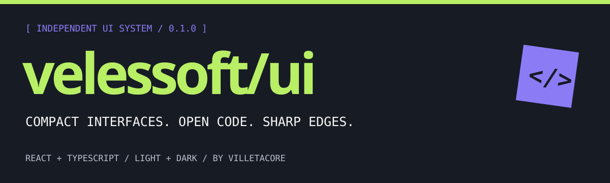
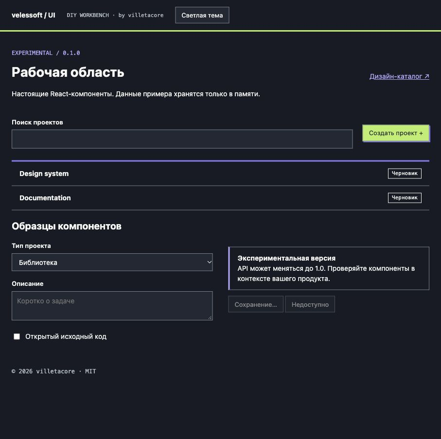
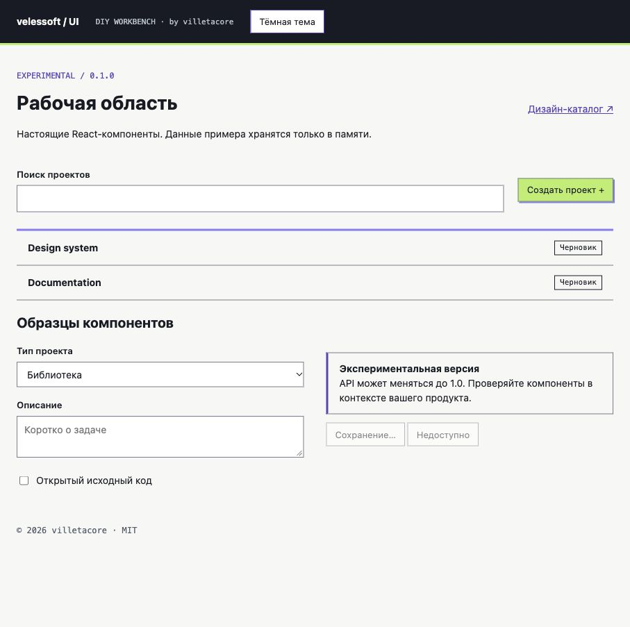
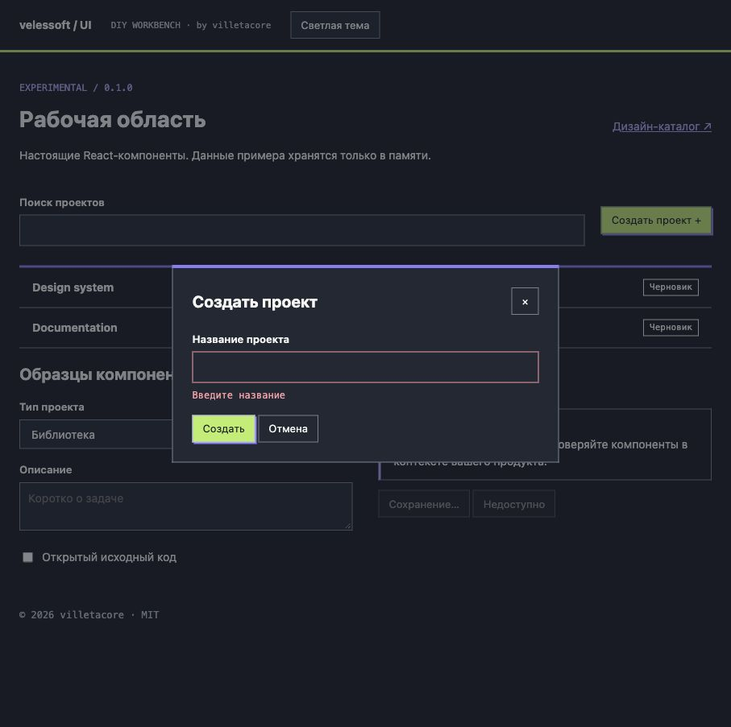

<p align="center"></p>

<p align="center">
<a href="https://github.com/villetacore/velessoft-ui/actions/workflows/ci.yml"></a>
<a href="LICENSE"></a>

</p>

<p align="center"><a href="docs/README.md">Documentation</a> · <a href="docs/getting-started.md">Quick start</a> · <a href="docs/components.md">Components</a> · <a href="docs/gallery.md">Screenshots</a> · <a href="README.ru.md">Русский</a></p>

**A compact React component library and open design system by [villetacore](https://github.com/villetacore).** Lime, violet and graphite. Sharp geometry, readable working surfaces, native controls.



## What is inside

| Layer | What you get |
| --- | --- |
| **React library** | Eight typed components, forwarded field refs, linked labels and error descriptions. |
| **Theme tokens** | JSON source and generated CSS variables for light and dark themes. |
| **Design catalog** | Brand rules, screen patterns, state laboratory and a local CRUD prototype. |
| **Working example** | A React workspace with project creation, search, validation and theme switching. |

**0.1.0 is experimental.** APIs may change. This is a small foundation, not a complete application framework or an accessibility certification.

## Install the library

The public GitHub package archives are installable with npm. An npm-registry release is not yet available.

```sh
npm install react react-dom
npm install https://raw.githubusercontent.com/villetacore/velessoft-ui/main/releases/v0.1.0/velessoft-tokens-0.1.0.tgz https://raw.githubusercontent.com/villetacore/velessoft-ui/main/releases/v0.1.0/velessoft-ui-0.1.0.tgz
```

```tsx
import { Button, Input } from '@velessoft/ui';
import '@velessoft/tokens/tokens.css';
import '@velessoft/ui/styles.css';

export function ProjectForm() {
  return (
    <form onSubmit={(event) => event.preventDefault()}>
      <Input label="Project name" name="name" required />
      <Button type="submit" variant="primary">Create project</Button>
    </form>
  );
}
```

For validated, controlled forms see [recipes](docs/recipes.md). Scope dark mode with `<div data-theme="dark">`.

## Explore locally

Use **Node.js 22.12+ on the 22 LTS line**, or Node 24/26, and npm.

```sh
git clone https://github.com/villetacore/velessoft-ui.git
cd velessoft-ui
npm ci
npm run dev
```

Open the address printed by Vite. Follow **Дизайн-каталог ↗** to open the offline design guide. React demo data lives in memory; the catalog's separate prototype uses localStorage when available.

```sh
npm run check    # TypeScript, interaction tests, production build
npm run pack     # Build installable packages in artifacts/
```

## One system, two themes

| Light workspace | Dialog validation |
| --- | --- |
|  |  |

[View the full gallery →](docs/gallery.md)

## Components

**Button · Input · Textarea · Select · Checkbox · Badge · Alert · Dialog**

Controls start at 34px on desktop and 44px on coarse pointers. Components inherit your font and use `--vs-*` semantic tokens. [API reference →](docs/components.md)

## Repository map

```text
packages/ui/          React source, scoped CSS, type declarations
packages/tokens/      Token source + generated CSS
apps/docs/public/     Offline design catalog
examples/dashboard/  Real React example
 docs/                Guides, recipes and screenshots
 design/              Principles and delivery templates
 releases/v0.1.0/     Installable package archives + checksums
```

## Contribute

Start with [CONTRIBUTING](CONTRIBUTING.md). Keep changes small, document behavior and include screenshots for visual work. [Roadmap](docs/roadmap.md) · [Changelog](CHANGELOG.md) · [Report an issue](https://github.com/villetacore/velessoft-ui/issues).

## License

MIT © 2026 **villetacore (Виллета Корь)**. Fonts and icons retain their original licenses; see [third-party notices](THIRD_PARTY_NOTICES.md). Early generated branding images are reference concepts. No trademark rights are granted by the code license.
