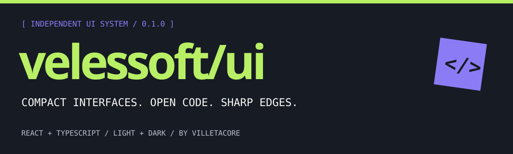
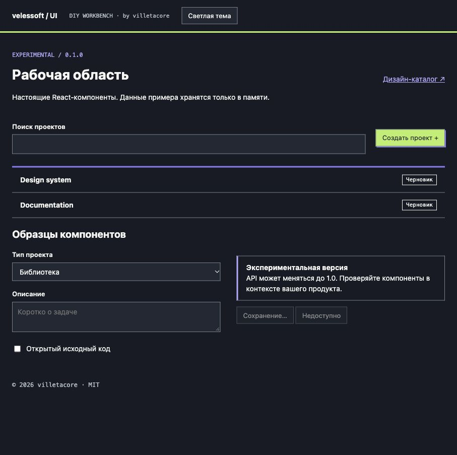

# Velessoft UI



**Компактная дизайн-система и библиотека компонентов от [villetacore](https://github.com/villetacore), которая работает в любом стеке.**

[Демо](https://villetacore.github.io/velessoft-ui/) · [Документация](docs/README.md) · [Компоненты](docs/components.md) · [Фреймворки](docs/frameworks.md) · [English](README.md)

## Пакеты

| Пакет | Для чего |
| --- | --- |
| `@villetacore/velessoft-ui` | **React 18+**: 35+ типизированных доступных компонентов. Next.js (App Router), Remix, Vite. |
| `@villetacore/velessoft-elements` | **Web Components** для интерактивных частей: вкладки, диалог, меню, подсказки, уведомления, пагинация, переключатель темы. **Vue, Svelte, Angular, Solid, Astro, htmx и обычный HTML.** Без зависимостей. |
| `@villetacore/velessoft-css` | **CSS без фреймворка**: все компоненты как классы `vs-*`. ~5 кБ gzip, можно подключать с CDN. |
| `@villetacore/velessoft-tokens` | **Токены**: CSS-переменные, SCSS, JSON/JS с типами, пресеты Tailwind v3 и v4. |

Статус — **0.2.0 experimental**: API может меняться до 1.0.

## Установка

```sh
# React
npm install @villetacore/velessoft-ui @villetacore/velessoft-tokens

# Vue / Svelte / Angular / Solid / HTML
npm install @villetacore/velessoft-css @villetacore/velessoft-tokens @villetacore/velessoft-elements
```

> Публикация в npm настроена через GitHub Actions ([инструкция](docs/releasing.md)). До первого релиза соберите архивы командой `npm run pack`.

```tsx
import { Button, VelessoftProvider, en } from '@villetacore/velessoft-ui';
import '@villetacore/velessoft-tokens/tokens.css';
import '@villetacore/velessoft-ui/styles.css';
```

Без сборки:

```html
<link rel="stylesheet" href="https://cdn.jsdelivr.net/npm/@villetacore/velessoft-css@0.2/dist/velessoft.full.min.css">
<script type="module" src="https://cdn.jsdelivr.net/npm/@villetacore/velessoft-elements@0.2/dist/index.js"></script>
<button class="vs-button vs-primary">Создать</button>
```

Подписи компонентов («Закрыть», «Загрузка…», пагинация) по умолчанию на русском; для английского оберните приложение в `<VelessoftProvider messages={en}>`.

## Запустить примеры

Node 22.12+, 24 или 26.

```sh
npm ci
npm run dev
```

Главная страница — React-пример, `/examples/html/` — та же система только на CSS и Web Components, `/public/` — дизайн-каталог. `npm run check` запускает проверки, `npm run verify:packages` устанавливает собранные пакеты в чистый проект, `npm run pack` собирает архивы в `artifacts/`.



## Границы готовности

Это библиотека интерфейсных элементов и локальные примеры, серверной части нет. Диалог использует нативный HTML `dialog`; доступность в конкретном продукте нужно проверять отдельно ([чек-лист](docs/accessibility.md)).

MIT © 2026 villetacore. [Лицензии сторонних материалов](THIRD_PARTY_NOTICES.md).
