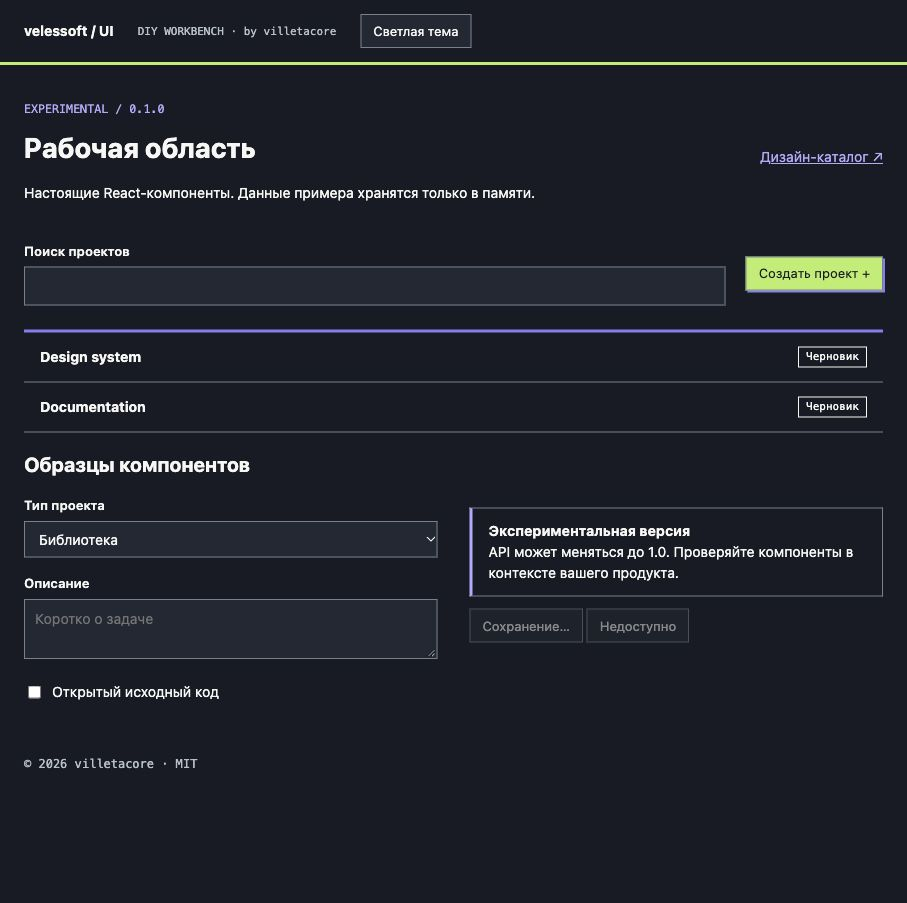
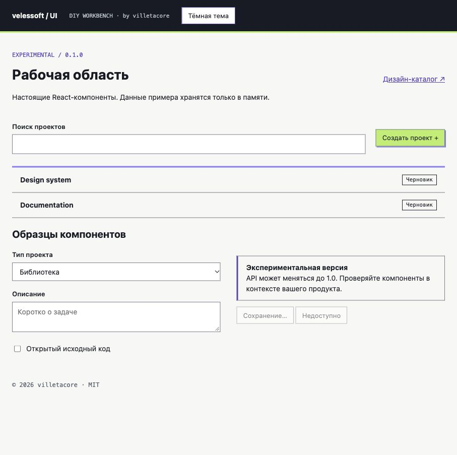
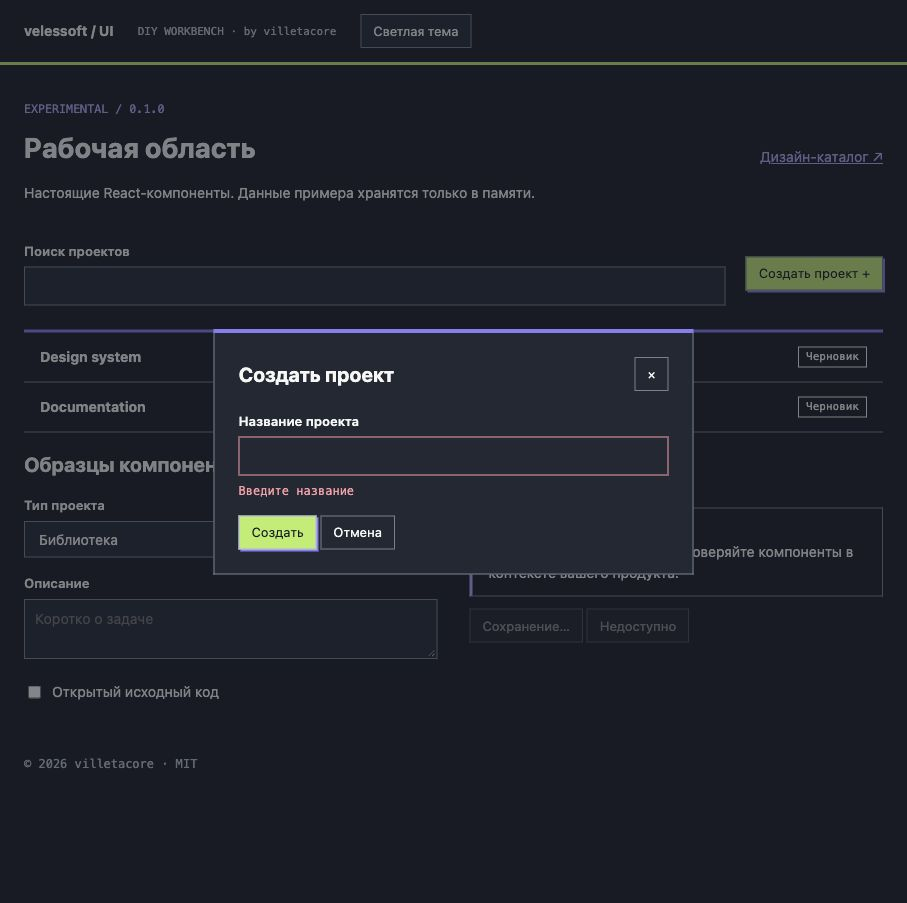
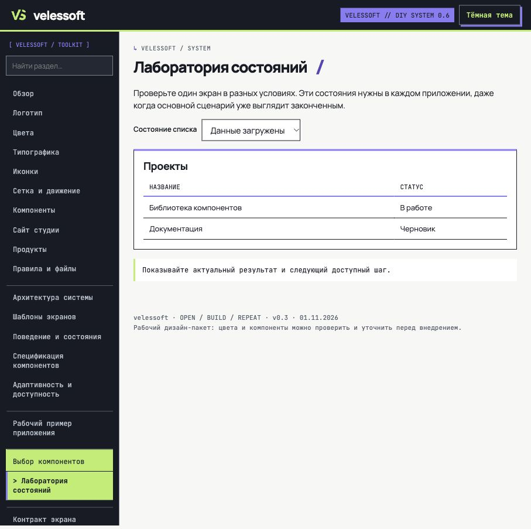

# Gallery

[Documentation](README.md) / Gallery

Actual browser captures from the local development app, 2 November 2026. These show the experimental implementation, not rendered concept images.

## Dark workspace

## Light workspace

## Validation inside a modal

Submitting an empty project name keeps the dialog open and exposes the linked error description.

## State laboratory

The design catalog demonstrates ready, loading, empty, error, offline and permission states. Retry in this laboratory simulates success; it does not call an API.

## Refreshing screenshots

Run `npm run dev`. Capture the root page in both themes, open the project dialog and submit an empty name, then open `/public/index.html#state-lab`. Keep real personal data out of examples. Save browser captures as JPEG in `docs/images/`; do not replace screenshots with generated mockups.
